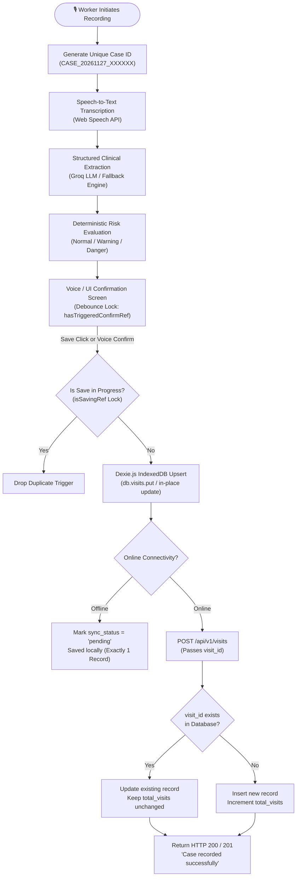
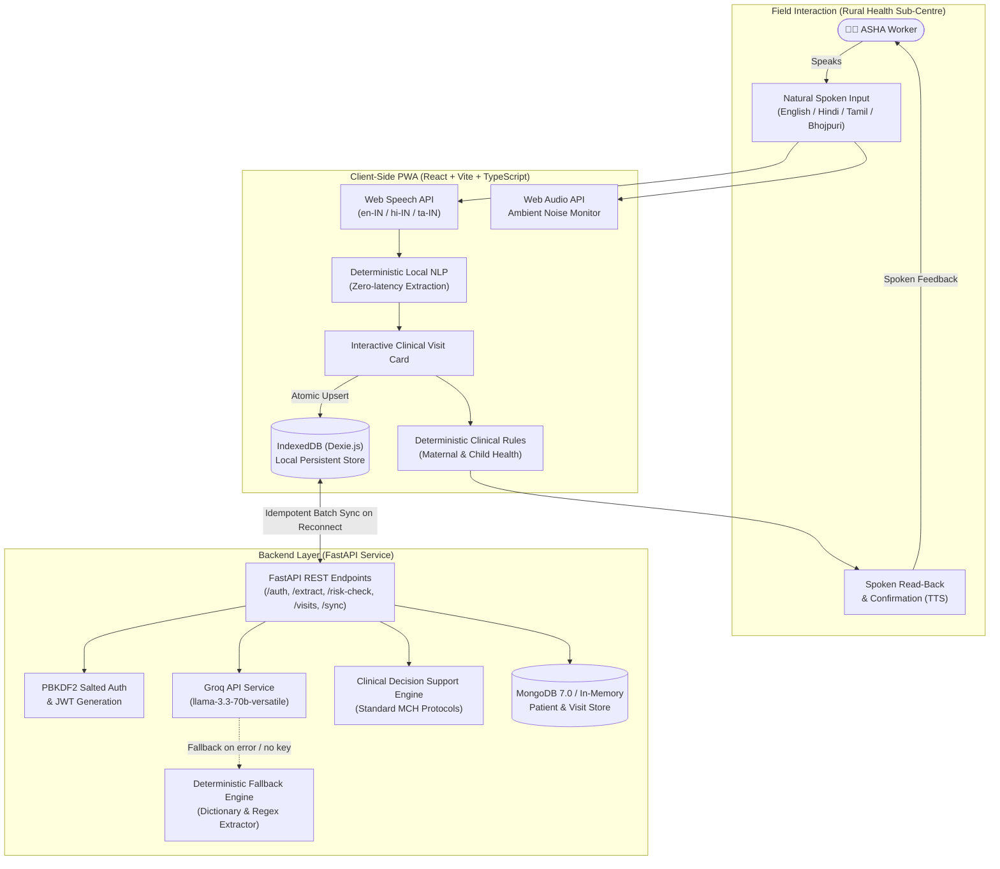

# ASHA Awaaz — Voice-First Healthcare Register for ASHA Workers

<div align="center">


**"Your voice. Their health. Better care."**  
*Empowering Accredited Social Health Activists (ASHA) across rural India with natural voice-to-health record capture in English, Hindi, Tamil, and Bhojpuri.*

[Live Evaluation Guide](#evaluation-demo-account) • [Duplicate Prevention Architecture](#duplicate-prevention--idempotency-architecture) • [System Architecture](#system-architecture) • [Quick Start](#quick-start-guide) • [CI/CD & Docker](#cicd-pipeline--docker) • [Clinical Risk Engine](#clinical-danger-rules)

</div>

---

## 1. What is ASHA Awaaz?

**ASHA Awaaz** (आशा आवाज़ / ஆஷா அவாஸ் / आशा आवाज) is a voice-first, offline-capable Progressive Web Application built specifically for India's **1,000,000+ Accredited Social Health Activist (ASHA)** community health workers.

During home visits in rural and semi-urban communities, ASHA workers monitor pregnant women, newborn infants, immunization schedules, and maternal risk vitals. Currently, this requires manually entering repetitive clinical data across **4 to 8 physical paper registers**, leading to severe paperwork fatigue, delayed reporting of maternal complications, and high rates of data loss.

With **ASHA Awaaz**, the worker does not type. She simply speaks naturally in **English**, **Hindi**, **Tamil**, or **Bhojpuri**:

> *"Sunita, 7 mahine ki pregnant hai, BP 150 by 100 hai, pairon mein sujan hai aur iron ki goli nahi li."*

### What the Application Does:
1. **Transcribes** natural spoken medical narrative in real-time with ambient noise monitoring.
2. **Extracts** structured clinical JSON records using an LLM (Groq / LLaMA 3.3) or local zero-latency deterministic extraction engine.
3. **Reads back** the extracted summary aloud in the worker's active language for immediate verification.
4. **Accepts single-field voice corrections** (*"Nahi, BP 140 by 90 hai"*) without overwriting unaffected fields.
5. **Evaluates deterministic clinical danger signs** (e.g. preeclampsia, gestational hypertension, neonatal sepsis) and triggers 1-tap **Call ANM** and **108 Ambulance** hotlines.
6. **Eliminates duplicates** using a single unified Case ID lifecycle and idempotent storage.
7. **Persists offline** in browser IndexedDB (Dexie.js) with automatic background synchronization when internet connectivity returns.

**Core Principle:** No typing is required for the primary field workflow.

---

## 2. Evaluation Demo Access

For hackathon evaluators and judges, the application includes a secure **1-Click Evaluator Demo Access** workflow directly on the Sign In page that provisions an isolated, scoped demo session without exposing sensitive credentials in client bundles:

| Field | Evaluation Access Detail |
|---|---|
| **Live Web App** | https://frontend-seven-xi-3gymmbfqqb.vercel.app |
| **Demo Session** | Smt. Kavita Sharma (Senior ASHA Worker, PHC Rampur) |
| **1-Click Demo Login** | Click **"⚡ 1-Click Demo Evaluation"** on the Sign In page |
| **Zero-Mic Simulation**| Click **"Run Demo (No Mic)"** on the top navigation bar |
| **Custom Registration**| Register any new account on `/signup` for a clean personal dashboard |

---

## 3. Key Innovations & Product Features

### 🎙️ 1. Multi-Lingual Voice First Experience
- **English as Default:** Opens in clean English for global accessibility, with instant switching to **हिंदी (Hindi)**, **தமிழ் (Tamil)**, or **भोजपुरी (Bhojpuri)**.
- **Synchronized Voice & UI:** When the language changes, speech recognition (`en-IN`, `hi-IN`, `ta-IN`), text-to-speech audio read-backs, error toasts, and risk banners switch instantly without page reload.
- **Ambient Noise Detection:** Built-in Web Audio API monitor alerts the worker if background village noise is too loud for reliable recognition.

### 🛡️ 2. Duplicate Case/Visit Record Elimination
- **Single Case ID Lifecycle:** Generates a unique `CASE_{TIMESTAMP}_{RANDOM}` identifier upon opening the recording session.
- **Idempotent Storage:** Both IndexedDB and the FastAPI backend treat saves with the same `visit_id` as idempotent in-place updates rather than new inserts.
- **Speech Recognition Debounce:** Guards against browser Web Speech API duplicate event triggers ("ha" intermediate vs "haan" final).
- **Risk Isolation:** Normal, Warning, and Dangerous classifications update the patient's risk status metadata without triggering extra database rows (1 visit = 1 record).

### 🎨 3. Thoughtful UI/UX & Design System
- **Public Landing Page:** Interactive showcase with feature deep-dives, clinical impact metrics, workflow timeline, and legal modals.
- **Split-Screen Authentication:** Modern 50/50 desktop split featuring custom Indian healthcare SVG illustrations, password strength meters, and show/hide password toggles.
- **Global Light / Dark Modes:** High-contrast color palette (`#1B5E20` deep forest green, `#162C21` dark charcoal) engineered for outdoor sunlight readability and night visits.
- **Safe Sign-Out Modal:** Checks for un-synced offline records and warns the worker before logout to prevent local data loss.

---

## 4. Duplicate Prevention & Idempotency Architecture

One critical requirement in rural health informatics is ensuring records are never duplicated, even under unstable network conditions, repeated button clicks, or intermediate voice recognition triggers:



### Idempotency Guarantees
- **Double-click protection:** Frontend `isSavingRef` immediately blocks subsequent clicks until async completion.
- **Voice confirmation debounce:** `hasTriggeredConfirmRef` ensures intermediate speech hypotheses do not call save repeatedly.
- **Offline batch sync:** `/api/v1/sync` filters out any visit ID already present in the database.
- **Risk categorization:** High-risk (danger), moderate-risk (warning), and normal visits all execute through the exact same single-save pipeline.

---

## 5. System Architecture



---

## 6. Clinical Danger Rules (Decision Support)

> [!IMPORTANT]
> ASHA Awaaz provides **clinical decision support** based on Government of India Maternal & Child Health (MCH/RCH) guidelines. It is not an automated diagnostic system; it assists frontline workers in triaging and expediting institutional referrals.

| Risk Category | Clinical Trigger | Recommended Action |
|---|---|---|
| 🚨 **DANGER** | Systolic BP $\ge$ 140 mmHg OR Diastolic BP $\ge$ 90 mmHg with Swelling (Preeclampsia) | Immediate referral to PHC/FRU; 1-tap **Call ANM** |
| 🚨 **DANGER** | Newborn body temperature $\ge$ 100.4°F ($\ge$ 38°C) within first 60 days (Neonatal Sepsis) | Immediate referral; keep infant warm; Call 108 |
| 🚨 **DANGER** | Reduced or absent fetal movements in 3rd trimester | Urgent ultrasound and Medical Officer referral |
| 🚨 **DANGER** | Antepartum vaginal bleeding at any gestational age | Emergency transport via 108 Ambulance |
| ⚠️ **WARNING** | Mild hypertension (Systolic $\ge$ 130 or Diastolic $\ge$ 85 without swelling) | Schedule follow-up visit within 48-72 hours |
| ⚠️ **WARNING** | Patient missed Iron-Folic Acid (IFA) supplements | Nutritional counseling and IFA replenishment |
| ✅ **NORMAL** | Vitals within normal physiological limits | Routine monthly ANC/PNC tracking |

---

## 7. Technology Stack

### Frontend Application
- **Framework:** React 18 with TypeScript and Vite
- **Styling:** Tailwind CSS with custom medical theme palette and dark mode support
- **Icons:** Lucide React
- **Local Persistence:** IndexedDB via **Dexie.js**
- **Speech-to-Text:** Web Speech API (`SpeechRecognition` / `webkitSpeechRecognition`)
- **Text-to-Speech:** Browser `SpeechSynthesis` API with language-matched accents
- **Audio Monitoring:** Web Audio API (`AudioContext`, `AnalyserNode`)

### Backend Service
- **Framework:** Python 3.12 with **FastAPI** and **Pydantic v2**
- **Authentication:** Salted PBKDF2 password hashing & JSON Web Tokens (`PyJWT`)
- **AI Engine:** **Groq Cloud API** (`llama-3.3-70b-versatile` / `llama-3.1-8b-instant`)
- **Fallback Extraction:** Deterministic, regex-based medical NLP dictionary
- **Database:** MongoDB 7.0 via Motor async driver with in-memory fallback store
- **Testing:** **pytest**, **pytest-asyncio**, and **httpx** (26 passing tests)

---

## 8. CI/CD Pipeline & Docker

The repository includes enterprise-grade CI/CD and container orchestration files:

### 1. GitHub Actions Workflow (`.github/workflows/ci.yml`)
Runs automatically on every `push` and `pull_request` to `main`:
- **Backend Job:** Installs Python 3.12 dependencies and executes the entire 26-test pytest suite.
- **Frontend Job:** Sets up Node.js 20, caches npm dependencies, and runs strict `tsc && vite build` bundle validation.

### 2. Docker Compose (`docker-compose.yml`)
Spin up the entire stack with a single command:
```bash
docker compose up --build
```
This deploys:
- `backend`: FastAPI server running on `http://localhost:8000` with hot-reload support.
- `mongodb`: Official MongoDB 7.0 container with persistent named volume storage.

### 3. Cloud Deployment Blueprint (`render.yaml`)
Turnkey cloud infrastructure specification for 1-click PaaS deployment on Render or Railway.

---

## 9. Quick Start Guide

### Prerequisites
- **Node.js** (v18 or higher) and `npm`
- **Python** (v3.10 or higher) and `pip`
- *Optional:* Docker & Docker Compose

---

### Step 1: Clone Repository
```bash
git clone https://github.com/kalashkumarithakur/ASHA-Awaaz.git
cd "ASHA Awaaz"
```

---

### Step 2: Configure Environment Variables
Copy the provided environment templates:
```bash
# In project root
cp .env.example .env
```
*(The backend defaults to in-memory mode if no MongoDB or Groq keys are configured — it runs out of the box!)*

---

### Step 3: Run Backend Service
```bash
cd backend
python3 -m venv venv
source venv/bin/activate    # On Windows: venv\Scripts\activate
pip install -r requirements.txt

# Start FastAPI server on port 8000
uvicorn app.main:app --reload --port 8000
```

---

### Step 4: Run Frontend PWA
In a new terminal window:
```bash
cd frontend
npm install
npm run dev
```

Open your browser at **http://localhost:5173**.

---

### Step 5: Run Automated Tests
Execute the full automated test suite (26 tests covering extraction, risk engine, and idempotency):
```bash
# From the project root
backend/venv/bin/pytest backend/tests -v
```

Expected output:
```text
============================== 26 passed in 0.40s ==============================
```

Verify frontend compilation:
```bash
cd frontend && npm run build
```

---

## 10. Backend API Endpoints

| Method | Endpoint | Description |
|---|---|---|
| `GET` | `/health` | Health check, DB connection mode, and Groq status |
| `POST` | `/api/v1/auth/login` | Authenticate worker with email/password; returns JWT |
| `POST` | `/api/v1/auth/signup` | Register new ASHA worker account |
| `POST` | `/api/v1/auth/logout` | Revoke session |
| `GET` | `/api/v1/worker/me` | Retrieve authenticated worker profile |
| `POST` | `/api/v1/extract` | Converts voice transcript to structured clinical JSON |
| `POST` | `/api/v1/risk-check` | Evaluates deterministic danger signs and returns alert flags |
| `POST` | `/api/v1/visits` | **Idempotent save** of confirmed visit record (upsert by `visit_id`) |
| `GET` | `/api/v1/visits` | Lists visit records with pagination |
| `GET` | `/api/v1/visits/{id}` | Fetches individual visit by ID |
| `PUT` | `/api/v1/visits/{id}` | Updates existing visit record |
| `GET` | `/api/v1/patients` | Lists registered patients with search filtering |
| `GET` | `/api/v1/patients/{id}/history` | Retrieves chronological timeline for a specific patient |
| `POST` | `/api/v1/sync` | **Idempotent batch synchronization** for offline records |

---

## 11. Automated Test Suite (29 Passing Tests)

| Test File | Test Case | Purpose |
|---|---|---|
| `test_api.py` | `test_health_endpoint` | Verifies system health, DB status, and fallback readiness |
| `test_api.py` | `test_extract_endpoint_success` | Validates voice transcript extraction API |
| `test_api.py` | `test_extract_endpoint_invalid_short_transcript` | Enforces minimum transcript length validation |
| `test_api.py` | `test_risk_check_endpoint` | Tests clinical danger evaluation API |
| `test_api.py` | `test_create_and_get_visit` | Verifies visit creation and subsequent retrieval |
| `test_api.py` | `test_duplicate_sync_prevention` | Ensures batch offline sync skips duplicate records |
| `test_api.py` | `test_patient_list_and_history` | Tests patient indexing and timeline retrieval |
| `test_api.py` | `test_worker_profile` | Tests worker profile endpoint |
| `test_api.py` | `test_auth_flow_signup_login` | Tests PBKDF2 registration, login, and JWT verification |
| `test_api.py` | `test_scenarios_normal_danger_warning_each_saved_exactly_once` | **Guarantees 1 record for normal, warning, and danger cases** |
| `test_api.py` | `test_repeated_and_double_click_requests_idempotency` | **Verifies double-clicks and repeated requests create 0 duplicates** |
| `test_api.py` | `test_editing_already_saved_case_updates_without_duplicate` | **Ensures editing a saved case updates in place** |
| `test_api.py` | `test_offline_save_followed_by_online_sync` | **Ensures offline save followed by sync creates exactly 1 record** |
| `test_api.py` | `test_demo_account_login_success` | **Guarantees demo account (kavita.asha@gov.in) logs in with 200 OK** |
| `test_api.py` | `test_demo_account_wrong_password_rejected` | **Rejects incorrect credentials with 401 Unauthorized** |
| `test_api.py` | `test_user_data_isolation_multi_tenant` | **Strict user isolation: New user gets empty dashboard; cannot view/edit demo data** |
| `test_extraction.py` | `test_hindi_hinglish_sample_extraction` | Validates extraction from Hindi/Hinglish speech |
| `test_extraction.py` | `test_tamil_sample_extraction` | Validates extraction from Tamil regional phrasing |
| `test_extraction.py` | `test_newborn_extraction` | Verifies neonatal vitals and age parsing |
| `test_extraction.py` | `test_child_extraction` | Verifies child vitals and immunization checks |
| `test_extraction.py` | `test_voice_correction_single_field` | **Confirms voice correction updates only targeted field** |
| `test_extraction.py` | `test_missing_fields_detection` | Detects missing critical clinical parameters |
| `test_extraction.py` | `test_spoken_summaries_generation` | Validates natural read-back audio generation in HI/TA/EN |
| `test_risk_engine.py` | `test_high_bp_pregnancy_danger` | Flags gestational hypertension (BP $\ge$ 140/90) |
| `test_risk_engine.py` | `test_preeclampsia_swelling_plus_high_bp` | Flags preeclampsia (high BP + pedal edema) |
| `test_risk_engine.py` | `test_newborn_fever_danger` | Flags neonatal fever ($\ge$ 100.4°F) |
| `test_risk_engine.py` | `test_absent_fetal_movement_danger` | Flags absent/reduced fetal movement |
| `test_risk_engine.py` | `test_bleeding_pregnancy_danger` | Flags antepartum hemorrhage |
| `test_risk_engine.py` | `test_normal_visit_no_danger` | Verifies normal visit generates no false alerts |

---

## 12. Project Structure

```text
ASHA Awaaz/
├── .github/
│   └── workflows/
│       └── ci.yml             # GitHub Actions CI/CD (Pytest + Vite Build)
├── backend/
│   ├── app/
│   │   ├── api/
│   │   │   └── routes/        # Auth, visits, extraction, risk, sync routes
│   │   ├── core/              # Config, security, clinical risk rules
│   │   ├── database/          # MongoDB & in-memory async fallback store
│   │   ├── schemas/           # Pydantic v2 validation models
│   │   ├── services/          # Groq LLM client & deterministic NLP engine
│   │   └── main.py            # FastAPI application entrypoint
│   ├── tests/                 # 26 automated unit & integration tests
│   ├── Dockerfile             # Production backend container definition
│   └── requirements.txt       # Python dependencies
├── frontend/
│   ├── src/
│   │   ├── components/        # VoiceRecorder, VisitCard, RiskBanner, Header, etc.
│   │   ├── i18n/              # Centralized translation files (EN, HI, TA, BHO)
│   │   ├── pages/             # LandingPage, LoginPage, SignupPage
│   │   ├── services/          # Auth service, Dexie IndexedDB, audio, API client
│   │   ├── types.ts           # TypeScript domain definitions
│   │   └── App.tsx            # Main application router and state coordinator
│   ├── package.json
│   ├── tailwind.config.js     # Medical design palette & dark mode configuration
│   └── vite.config.ts
├── docker-compose.yml         # Container composition (FastAPI + MongoDB)
├── render.yaml                # 1-click cloud deployment blueprint
├── .env.example               # Environment configuration template
└── README.md                  # Comprehensive project documentation
```

---

<div align="center">
  <b>Built with ❤️ for India's Frontline Healthcare Heroes.</b><br/>
  <i>Wispr Flow Build for Bharat Hackathon 2026</i>
</div>
