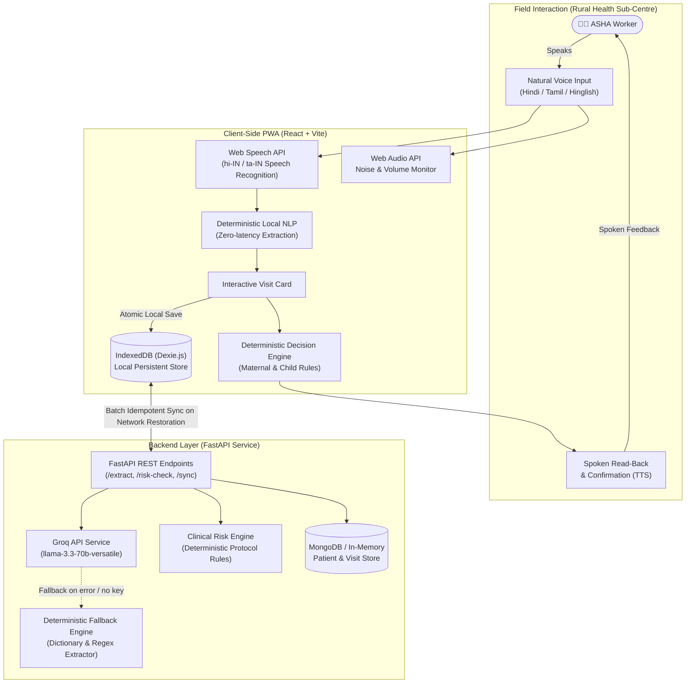
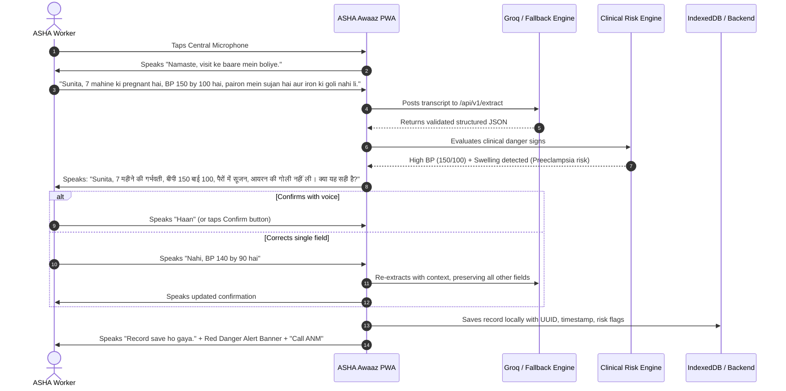

# ASHA Awaaz — Voice-First Healthcare Register for ASHA Workers

<div align="center">


**Empowering Accredited Social Health Activists (ASHA) across rural India with natural voice-to-health record capture in Hindi, Tamil, and Hinglish.**

[System Architecture](#system-architecture) • [Demo Mode](#demo-mode) • [Quick Start](#quick-start-guide) • [Clinical Risk Engine](#clinical-danger-rules) • [API Documentation](#backend-api-endpoints)

</div>

---

## 1. What is ASHA Awaaz?

**ASHA Awaaz** (आशा आवाज़ / ஆஷா அவாஸ்) is a voice-first, offline-capable Progressive Web Application designed specifically for Accredited Social Health Activist (ASHA) community health workers in rural and semi-urban India.

Instead of writing complex medical details across 4 to 8 separate physical paper registers, an ASHA worker simply speaks naturally in **Hindi**, **Tamil**, **English**, or **Hinglish** during or after a home visit:

> *"Sunita, 7 mahine ki pregnant hai, BP 150 by 100 hai, pairon mein sujan hai aur iron ki goli nahi li."*

ASHA Awaaz:
1. **Transcribes** natural spoken medical narrative in real-time.
2. **Extracts** structured clinical JSON records via **Groq LLM** or a local zero-latency deterministic extraction engine.
3. **Reads back** the extracted summary aloud in the worker's selected language using speech synthesis.
4. **Allows voice corrections** (*"Nahi, BP 140 by 90 hai"*) without overwriting unrelated fields.
5. **Evaluates deterministic clinical danger signs** (e.g. preeclampsia, gestational hypertension, neonatal fever) and triggers immediate alerts with 1-tap **Call ANM** hotline support.
6. **Saves locally** into IndexedDB (Dexie.js) with background synchronization to the cloud whenever connectivity returns.

**Core Principle:** No typing is required for the primary field workflow.

---

## 2. The Problem It Solves

Rural ASHA workers face immense logistical challenges:
- **Repetitive Paperwork:** Recording the same maternal and neonatal metrics across multiple government paper registers leads to worker burnout and data loss.
- **Language & Literacy Barriers:** Existing digital health portals demand typing in English or navigating complex multi-step form screens on low-cost Android phones.
- **Intermittent Connectivity:** Rural villages frequently have 2G or zero cellular data coverage.
- **Delayed High-Risk Detection:** Maternal danger signs like severe preeclampsia or neonatal sepsis often go unnoticed until clinical complications arise.

ASHA Awaaz removes the keyboard entirely, turning natural conversation into verifiable, structured clinical health records.

---

## 3. Technology Stack

### Frontend PWA
- **Framework:** React 18 with TypeScript and Vite.
- **Styling:** Tailwind CSS with a warm healthcare green design system (`#1B5E20`, `#2E7D32`), high-contrast text, minimum 48px touch targets, and outdoor sunlight readability.
- **Speech Recognition:** Web Speech API with dual-language support (`hi-IN` for Hindi, `ta-IN` for Tamil, and `en-IN` fallback).
- **Speech Synthesis:** Browser `SpeechSynthesis` API with natural cadence for Hindi & Tamil voice read-backs.
- **Audio Processing:** Web Audio API (`AudioContext`, `AnalyserNode`) for real-time ambient noise detection and warnings in crowded village environments.
- **Local Database:** IndexedDB powered by **Dexie.js** for zero-data-loss local persistence.
- **Offline & PWA:** Service Worker caching and Web App Manifest.

### Backend Service
- **Framework:** Python 3.12 with **FastAPI** and **Pydantic v2**.
- **AI Extraction Engine:** **Groq API** (`llama-3.3-70b-versatile` / `llama-3.1-8b-instant`) with strict JSON schema enforcement.
- **Fallback Extraction:** Deterministic, regex-based NLP engine with Hindi, Tamil, and Hinglish clinical vocabulary normalization (enabling 100% operation without API keys).
- **Database:** MongoDB with Motor async driver and an integrated in-memory fallback store ensuring instant boot and testing without external database dependencies.
- **Testing:** Comprehensive test suite with **pytest** and **pytest-asyncio** (21 automated unit and integration tests).

---

## 4. System Architecture



---

## 5. Voice Interaction Workflow



---

## 6. Clinical Danger Rules (Decision Support)

> [!IMPORTANT]
> ASHA Awaaz provides **clinical decision support** based on standard maternal and child healthcare protocols (MCH/RCH). It is not an automated diagnostic system and always emphasizes referral to trained medical personnel (ANM / Medical Officer at PHC).

1. **Gestational Hypertension:** Pregnant woman with systolic BP >= 140 mmHg OR diastolic BP >= 90 mmHg.
2. **Preeclampsia Danger:** Swelling in feet/limbs combined with high blood pressure.
3. **Neonatal Sepsis / High Fever:** Newborn (<= 60 days) with body temperature >= 100.4°F.
4. **Fetal Distress:** Absence or sudden reduction in fetal movement.
5. **Antepartum Hemorrhage:** Any vaginal bleeding reported during pregnancy.

When any rule is triggered:
- Prominent **red danger alert card** is displayed with the exact clinical reason.
- Spoken audio alert plays: *"सावधान! खतरे के लक्षण पाए गए हैं। तुरंत एएनएम दीदी या 108 एम्बुलेंस को कॉल करें और आज ही पीएचसी भेजें।"*
- Instant 1-tap **Call ANM** button dials the configurable Auxiliary Nurse Midwife (ANM) phone number (`+91 98765 43210`).
- Emergency **108 Ambulance** quick-dial button.

---

## 7. Demo Mode (Zero Credentials Required)

For hackathon evaluators and reviewers, ASHA Awaaz includes a **1-Click Interactive Demo Mode** that demonstrates the entire workflow without requiring microphone permissions, network access, or paid API keys.

1. Click the glowing **"डेमो चलाएं (बिना माइक)"** button in the header or home screen.
2. Choose one of the three pre-seeded fictional cases:
   - **Case 1 (Pregnant - High Risk):** *Sunita Devi* — 7 months pregnant, BP 150/100, swelling in feet, iron tablet missed (Triggers preeclampsia alert & Call ANM).
   - **Case 2 (Newborn - High Fever):** *Aarav Kumar* — 15 days newborn, fever 101.5°F, poor feeding (Triggers neonatal sepsis alert).
   - **Case 3 (Child - Routine Checkup):** *Meena Kumari* — 3 years old, 14 kg weight, normal healthy visit.
3. Watch the automated step-by-step simulation:
   - Spoken greeting
   - Real-time transcript generation
   - AI structured extraction
   - Voice confirmation read-back
   - Worker simulated confirmation (*"हाँ, सही है"*)
   - Clinical risk detection & danger card
   - Atomic IndexedDB save
   - Real-time patient history update

---

## 8. Quick Start Guide

### Prerequisites
- **Node.js** (v18 or higher) and `npm`
- **Python** (v3.10 or higher) and `pip`

---

### Step 1: Clone Repository
```bash
git clone https://github.com/kalashkumarithakur/ASHA-Awaaz.git
cd "ASHA Awaaz"
```

---

### Step 2: Run Backend Service
```bash
# Navigate to backend directory
cd backend

# Create and activate virtual environment
python3 -m venv venv
source venv/bin/activate    # On Windows: venv\Scripts\activate

# Install dependencies
pip install -r requirements.txt

# Run backend (starts on http://127.0.0.1:8000)
uvicorn app.main:app --reload --port 8000
```

> **Note:** The backend automatically falls back to an in-memory database and deterministic NLP engine if MongoDB or `GROQ_API_KEY` are not configured. It boots instantly without dependencies!

---

### Step 3: Run Frontend PWA
In a new terminal window:
```bash
# Navigate to frontend directory
cd frontend

# Install dependencies
npm install

# Start development server
npm run dev
```

Open your browser at **http://localhost:5173**.

---

### Step 4: Run Automated Tests
ASHA Awaaz includes 21 comprehensive automated backend unit and integration tests:
```bash
# From the project root
backend/venv/bin/pytest backend/tests -v
```

**Test Coverage Highlights:**
- Schema validation & invalid short transcript rejection
- Hindi & Hinglish natural medical narrative extraction
- Tamil regional sentence extraction
- Newborn fever and infant age extraction
- Single-field voice correction without data loss (*"Nahi, BP 140 by 90 hai"*)
- Missing clinical vitals detection
- Gestational hypertension & preeclampsia danger detection
- Antepartum bleeding & fetal movement absence detection
- Idempotent batch synchronization & duplicate prevention
- Patient history timeline and worker profile verification

---

## 9. Backend API Endpoints

| Method | Endpoint | Description |
|---|---|---|
| `GET` | `/health` | Health check, DB mode, and Groq status |
| `POST` | `/api/v1/extract` | Converts voice transcript to structured clinical JSON |
| `POST` | `/api/v1/risk-check` | Evaluates deterministic danger signs and returns alert flags |
| `POST` | `/api/v1/visits` | Saves a confirmed visit record |
| `GET` | `/api/v1/visits` | Lists past visit records with pagination |
| `GET` | `/api/v1/visits/{id}` | Fetches individual visit by ID |
| `PUT` | `/api/v1/visits/{id}` | Updates existing visit record |
| `GET` | `/api/v1/patients` | Lists registered patients with search filtering |
| `GET` | `/api/v1/patients/{id}/history` | Retrieves chronological timeline for a specific patient |
| `POST` | `/api/v1/sync` | Idempotent batch synchronization for offline records |
| `GET` | `/api/v1/worker/me` | Returns logged-in ASHA worker profile |

---

## 10. Environment Variables

Create a `.env` file in `backend/` (or copy from `.env.example`):

```env
# Optional: Groq LLM API Key (if omitted, deterministic engine handles extraction)
GROQ_API_KEY=your_groq_api_key_here
GROQ_MODEL=llama-3.3-70b-versatile

# Database (optional - defaults to in-memory store if MongoDB is offline)
MONGODB_URL=mongodb://localhost:27017
DATABASE_NAME=asha_awaaz

# Security
JWT_SECRET=asha-awaaz-secret-key-build-for-bharat-2026

# Clinical Thresholds (Configurable Decision Support)
DANGER_BP_SYSTOLIC=140
DANGER_BP_DIASTOLIC=90
DANGER_NEWBORN_TEMP_F=100.4

# Emergency Contacts
ANM_DEFAULT_PHONE=+91 98765 43210
PHC_HELPLINE=108
```

---

## 11. Known Limitations & Roadmap

- **Browser Web Speech API in Offline Mode:** On some entry-level Android devices, native Chrome speech recognition requires an internet connection for speech-to-text. ASHA Awaaz queues transcripts and audio clips locally and processes them as soon as connectivity resumes.
- **Microphone Hardware Quality:** High ambient noise in busy outdoor village haats can impact speech recognition. ASHA Awaaz includes real-time ambient noise warnings encouraging the worker to step into a quieter area.
- **Dialect Diversity:** While standard Hindi, Bhojpuri-accented Hindi, Tamil, and Hinglish medical loanwords are supported, additional regional dialects (e.g. Maithili, Telugu, Marathi) are planned for subsequent phases.

---

## 12. Deployment

### Frontend (Vercel / Netlify)
```bash
cd frontend
npm run build
# Deploy dist/ directory with VITE_API_URL set to your hosted backend
```

### Backend (Render / Railway / Docker)
```bash
# Using uvicorn on any Linux container host:
uvicorn app.main:app --host 0.0.0.0 --port $PORT
```

---

<div align="center">
  <b>Built with ❤️ for India's 1,000,000+ ASHA Community Health Workers.</b><br/>
  <i>Wispr Flow Build for Bharat Hackathon 2026</i>
</div>
# ASHA-Awaaz
