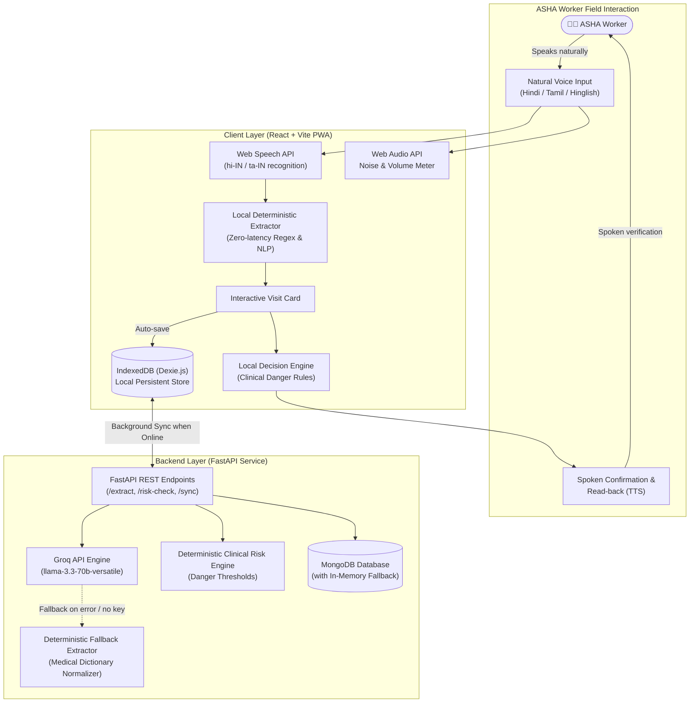
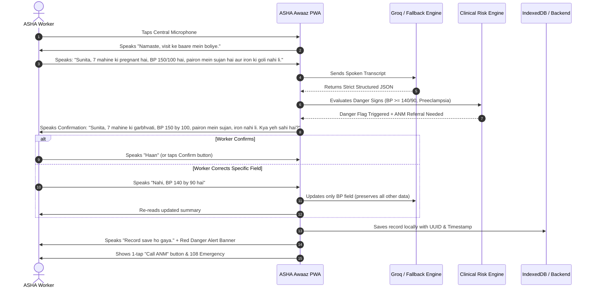

# ASHA Awaaz — System Architecture & Technical Specifications

**Voice-First Healthcare Register for ASHA Workers in Rural India**  
*Wispr Flow Build for Bharat Hackathon (Round 2 Prototype)*

---

## 1. High-Level Architecture Overview

ASHA Awaaz is an offline-first, voice-native Progressive Web Application (PWA) backed by a high-throughput FastAPI service, deterministic clinical decision engine, and Groq-powered LLM information extraction with dual-layer fallback.

---

## 2. Voice-to-Record Workflow & Confirmation Loop

---

## 3. Clinical Danger Sign Rules (Decision Support)

> [!IMPORTANT]
> The clinical danger engine provides decision support based on public maternal & child health guidelines (MCH / RCH protocols). It never acts as an independent diagnostic agent.

| Condition | Rule Threshold | Danger Flag | Emergency Action | Spoken Alert |
|---|---|---|---|---|
| **Gestational Hypertension** | Pregnant woman with Systolic BP >= 140 OR Diastolic BP >= 90 | `HIGH_BP_PREGNANCY` | Refer to PHC today for immediate clinical assessment | "सावधान! बीपी बढ़ा हुआ है।" |
| **Preeclampsia** | Swelling in feet/limbs + High BP (>= 140/90) | `PREECLAMPSIA_WARNING` | Urgent PHC referral to prevent convulsions | "प्री-एक्लेम्पसिया चेतावनी! तुरंत जांच कराएं।" |
| **Neonatal Sepsis / Fever** | Newborn (<= 60 days) with Temp >= 100.4°F | `NEWBORN_FEVER_DANGER` | Immediate referral to CHC / District Hospital. Keep baby warm. | "नवजात शिशु को तेज बुखार है।" |
| **Fetal Distress** | Absence or sudden reduction in fetal movement | `FETAL_MOVEMENT_DANGER` | Urgent fetal heart sound check and ultrasound | "गर्भ में बच्चे की हलचल बंद/कम है।" |
| **Antepartum Hemorrhage** | Any reported vaginal bleeding during pregnancy | `PREGNANCY_BLEEDING_DANGER` | Call 108 ambulance immediately to First Referral Unit (FRU) | "गंभीर आपातकालीन स्थिति: 108 बुलाएं।" |

---

## 4. Offline Synchronization & Idempotency

1. **Local-First Persistence**: Every visit is committed to IndexedDB (Dexie.js) before any network call is attempted.
2. **Sync Status Machine**:
   - `pending`: Stored on local device, pending cloud replication.
   - `synced`: Successfully confirmed by cloud backend.
   - `failed`: Temporary retry state.
3. **Idempotent Upsert**:
   - Every visit generates a globally unique identifier `visit_id` (e.g. `VISIT_1732661755334_A9F2`).
   - When network restores, the PWA sends a batch to `POST /api/v1/sync`.
   - The backend checks for duplicate `visit_id` and ignores existing records, guaranteeing zero duplication even under repeated retries.
